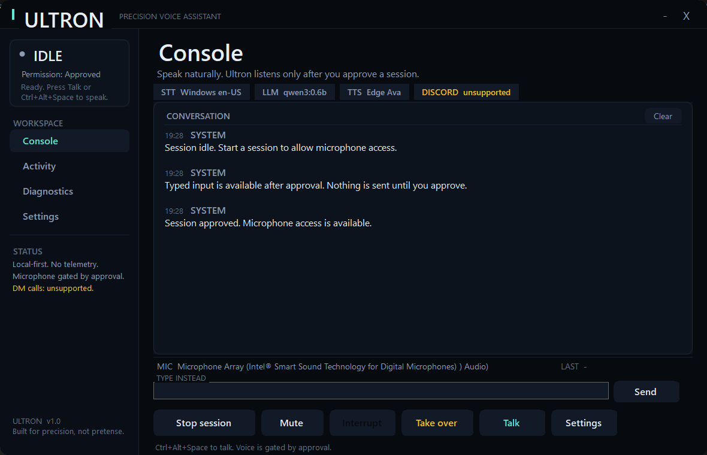

# Ultron

A permission-first Windows desktop voice assistant. It listens only after you approve a session, transcribes one phrase per **Talk** press, sends the text to a local Ollama model, and speaks the reply.

Ultron is deliberately small: C# WinForms on .NET Framework 4.8, no Electron, no Python, no cloud account for its core loop.



## What it does

- **Explicit session approval.** Every launch starts locked. The **Start session** button opens a permission dialog that states what the session will access. Approval requires pressing **Allow session**; a dialog result alone is not accepted.
- **Push-to-talk by default.** The microphone opens only when you press **Talk** or `Ctrl+Alt+Space`, and it closes after one result, rejection, or timeout. Clicking Talk again while it is open closes the microphone.
- **Speech-input choice.**
  - **Windows Speech** (default, better accuracy). Uses the modern Windows recognizer. It may send microphone audio to Microsoft's online speech service.
  - **Offline SAPI** (fallback, private). Recognition stays on this PC, but accuracy is materially lower.
- **Noise defense.** Filler-only results are dropped, the confidence floor defaults to **70%**, and low-confidence speech is either ignored or shown for review rather than silently sent.
- **Visible state.** The sidebar and status strip show Idle, Listening, Thinking, Speaking, Muted, Taken over, or Error. The activity log records what happened.
- **Interrupt, mute, stop session, take over.** These are real controls, not decorative labels.
- **Local language model.** Uses Ollama at `http://127.0.0.1:11434` with `qwen3:0.6b` by default.
- **Neural text-to-speech with fallback.** Edge neural voices when the Node helper is available; Windows SAPI otherwise.
- **No Discord DM-call interception.** See [docs/DISCORD_FEASIBILITY.md](docs/DISCORD_FEASIBILITY.md).

## Requirements

| Requirement | Notes |
|---|---|
| Windows 10/11 x64 | The build uses the in-box .NET Framework 4.8 compiler and WinRT metadata. |
| Ollama | Running locally. Pull a model first, for example `ollama pull qwen3:0.6b`. |
| Node.js (optional) | Needed for Edge neural TTS. The helper also needs `msedge-tts` and `ffmpeg-static` resolvable from this folder. This checkout links `node_modules` to the local Discord bot's modules; a fresh checkout should run `npm install` with those two packages, or use SAPI only. |
| Microphone | The default input device is used. A headset microphone usually gives better results than a laptop array. |
| Windows speech privacy | Required only for the **Windows Speech** engine. The app opens the right Settings page but does not change the setting for you. |

## Build and run

From this folder:

```powershell
.\build.ps1
.\UltronTests.exe
.\run.cmd
```

`run.cmd` builds if `Ultron.exe` is missing, then launches the app. `Ultron.exe --smoke` opens and closes the window after a couple of seconds and is useful for a quick launch check.

Build output:

- `Ultron.exe` — the desktop app
- `UltronTests.exe` — the self-test harness

The build needs the Windows WinRT metadata at `C:\Windows\System32\WinMetadata` and `System.Speech.dll` from the GAC. Both ship with Windows; `build.ps1` checks for them.

## First run

1. Start Ollama and make sure the configured model exists:
   ```powershell
   ollama list
   ollama pull qwen3:0.6b
   ```
2. Launch Ultron.
3. Press **Start session** and read the permission dialog. Press **Allow session** only if you want this session to use the microphone.
4. Press **Talk** (or `Ctrl+Alt+Space`) and speak one phrase.
5. Press **Talk** again if you want to cancel listening. Otherwise Ultron closes the microphone after the result or timeout.

### Enabling Windows Speech

Windows Speech is the better recognizer, but Windows will refuse to capture audio until you accept its speech privacy setting:

1. Open **Settings → Privacy & security → Speech**.
2. Turn on **Online speech recognition**.
3. Return to Ultron and press **Talk**.

The permission dialog and the Settings window both explain this. Ultron opens the Settings page from **Settings → Windows speech settings**; it does **not** enable the toggle silently. If you would rather keep all recognition offline, choose **Offline SAPI** in Settings.

If Ultron already fell back to SAPI before you enabled the setting, open **Settings** and press **Save settings** again. That retries Windows Speech without restarting the app; if Windows still blocks it, the app falls back again.

## Accuracy and noise handling

The measured SAPI baseline on this machine is poor. A clear test phrase, “Ultron, what is seventeen times twenty three?”, was transcribed by offline SAPI as “I'll try and play 17 times 23” at 33.6% confidence. That is why Windows Speech is the default and why SAPI is explicitly labeled as the lower-accuracy fallback.

Ultron now combines several defenses:

- **One phrase per press.** SAPI uses single-result mode; Windows Speech uses a one-shot `RecognizeAsync`. The microphone does not stay open for the next noise in the room.
- **Noise filter.** Filler-only phrases (“the”, “um”, “uh”) and punctuation-only results are rejected before reaching the model.
- **Confidence floor.** Results below the configured floor (70% by default) are not sent. A rejected result returns the UI to **Idle** with a retry message.
- **Review option.** Results between the floor and 85% can open the transcript review dialog for correction before sending.
- **Push-to-talk.** No wake word and no always-listening loop. This is intentional.

If accuracy is still poor, use a headset microphone and verify that Windows is using it as the default input. Laptop microphone arrays pick up fans, keyboards, and room speech.

## Privacy

- Microphone audio is captured only after **Start session → Allow session**, and only while the mic is open for a Talk press.
- **Windows Speech** may send audio to Microsoft. The permission dialog says so before approval.
- **Offline SAPI** does not send microphone audio off the machine.
- Transcribed text goes to **local Ollama**; no cloud LLM is configured by default.
- **Edge TTS** sends the *reply text* (not microphone audio) to Microsoft's speech service. SAPI TTS stays local.
- Settings are stored at `%APPDATA%\Ultron\settings.json`.
- Logs are stored at `%APPDATA%\Ultron\logs\`. They contain transcript/status messages; review them before sharing.
- No provider API keys are stored in settings. Discord is not connected, and no user token or self-bot is used.

## Discord

Ultron does **not** join private 1:1 Discord DM calls. Discord's documented voice API is guild/channel based, and Discord's calls use end-to-end encryption. There is no supported bot path to ordinary DM-call audio, and Ultron does not fake one. The full boundary, sources, and the legitimate server-voice-channel alternative are in [docs/DISCORD_FEASIBILITY.md](docs/DISCORD_FEASIBILITY.md).

## Project layout

```
src/
  MainForm.cs              UI, state machine, permission gate, push-to-talk
  PermissionDialog.cs      Explicit per-session approval
  SettingsDialog.cs        Engine, voice, confidence, history, prompt
  Theme.cs                 Colors, fonts, custom controls
  Core/
    AppSettings.cs         JSON settings + migration
    ISpeechInput.cs        Speech-engine contract
    WindowsSpeechInput.cs  WinRT one-shot recognizer
    SpeechInput.cs         Offline SAPI recognizer
    NoiseFilter.cs         Filler/noise rejection
    OllamaClient.cs        Local Ollama chat client
    SpeechOutput.cs        Edge/SAPI text-to-speech
    DiscordAdapter.cs      Documented unsupported boundary
tests/UltronTests.cs       14 self-tests
tools/                     Screenshot + Edge TTS helpers
docs/                      Feasibility notes and screenshots
```

## Tests

`UltronTests.exe` covers permission gating, redaction, Ollama streaming parsing, conversation history, settings round-trip and migration, noise filtering, Windows Speech availability, the Discord boundary, SAPI/Windows recognizer enumeration, offline SAPI STT, SAPI/Edge TTS, and a live local Ollama call.

Current result: **14 passed, 0 failed** (2026-10-20). The live Ollama and Edge TTS tests require those services/network, and skip or fail clearly when unavailable.

On a Windows 11 machine with **Smart App Control** enabled, the unsigned console test runner can be blocked by Device Guard even though the main app runs. The build therefore also produces `UltronTestsWin.exe`, the same harness compiled as a GUI app. Run it with an output file:

```powershell
Start-Process .\UltronTestsWin.exe -ArgumentList '--out','tests-output.txt' -Wait
Get-Content .\tests-output.txt -Encoding UTF8
```

## Troubleshooting

| Symptom | Cause / fix |
|---|---|
| “Windows Speech needs the Windows speech privacy setting” | Enable **Online speech recognition** in Windows Settings, or stay on offline SAPI. |
| “Microphone unavailable” | Check the default input device in Windows Sound settings. Close other apps that hold the microphone. |
| Ollama errors | Confirm `ollama list` works and the model in Settings matches an installed model. Test with **Settings → Test Ollama**. |
| Edge voice falls back to SAPI | Node/`msedge-tts` is unavailable or the network is down. SAPI is the local fallback. |
| Build says the file is in use | Close the running `Ultron.exe` first. |
| No speech detected | Press Talk, wait for the listening state, and speak one phrase. The mic closes after a timeout by design. |

## Not implemented

- Wake-word or always-listening mode
- Cloud LLM providers in the UI
- Discord bot/DM-call integration
- Screen vision or arbitrary desktop automation
- A packaged installer (run from this folder)

The app is intentionally approval-first; if a feature would require silent microphone access or an unsupported Discord path, it is left out rather than faked.
